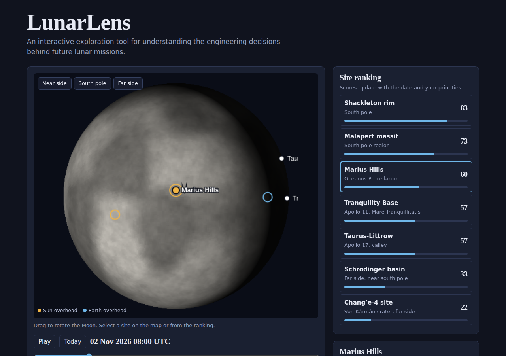

# LunarLens

An interactive exploration tool for understanding the engineering decisions behind future lunar missions.

LunarLens compares seven lunar landing sites by how much sunlight they get, how often Earth is in view, and how close they are to water ice. You can rotate the Moon, scrub through time, and change your priorities to see how the ranking changes.

This is an independent project inspired by the problem behind NASA's Space Apps challenge on comparing lunar landing sites, sunlight, and communication windows. It is not affiliated with NASA.

## Run it
Open `index.html` in any browser. There is nothing to install. (Fonts load from Google Fonts when online.)

## How it works
- The Sun's direction follows the 29.53-day lunar cycle, with the Moon's axial tilt (about 1.5 degrees).
- Earth's direction uses approximate libration in longitude and latitude.
- Elevation of the Sun or Earth at a site comes from one spherical-trigonometry formula (see `CODE_WALKTHROUGH.md`).
- Over a 30-day window it measures the fraction of time the Sun is up, the fraction of time Earth is in view, and the longest continuous night.
- The score is a weighted average of power, Earth link, and ice access.

## Limits
- No terrain data. A small offset stands in for high ground at some sites.
- Ice scores are rough qualitative estimates, not measurements.
- Sun and Earth positions are approximations, not real ephemeris data. `ephemeris_skyfield.py` shows how to replace them with JPL data.

## Sources checked
- Malapert massif (86 S, 0 E): LROC, Arizona State University
- Chang'e-4 landing site (45.457 S, 177.589 E): LROC, Arizona State University
- Artemis III candidate regions: NASA
